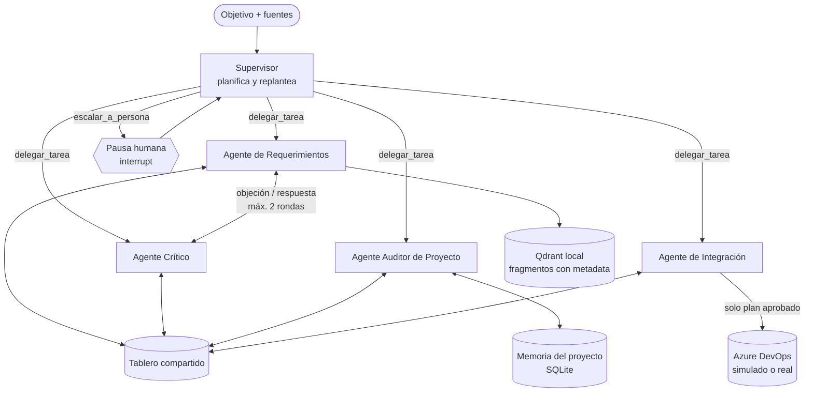

# BacklogGuard · Del Dicho al Backlog

Sistema multiagente que convierte reuniones, minutas y preventa en un backlog verificado, trazable y aprobado por personas antes de publicarse en Azure DevOps.

> Trabajo Final Integrador · Certificación Profesional en AI Agent Developer · ITBA Educación Ejecutiva
> Versión de entrega: `v1.0-tfi` · Entrega: domingo 6 de diciembre de 2026, 23:59 h

---

## 1. Nombre del proyecto
**BacklogGuard** (subtítulo: *Del Dicho al Backlog*).

## 2. Integrantes
⚠️ A COMPLETAR: nombre y apellido de todos los integrantes.

## 3. Problema
En una factory de desarrollo o en el proceso de toma de requerimientos, entre lo que se vende, lo que se conversa con el cliente y lo que termina en el backlog hay varias pérdidas:

- **Historias generadas con IA que nadie verifica.** Un error de transcripción, una frase mal interpretada o un requerimiento inventado llegan al backlog con la misma apariencia que uno válido. El problema aparece recién al validar la historia, con ciclos de corrección.
- **Desalineación entre preventa y ejecución.** Lo tratado pero no vendido se desarrolla sin facturarse. Lo vendido pero no tratado queda sin definir hasta que bloquea.
- **Contradicciones y decisiones perdidas entre reuniones.** Se pierde cuál es la versión vigente, y las preguntas técnicas abiertas reaparecen tarde como impedimentos.
- **Refinamiento manual y lento.** Revisar historia por historia, completar criterios, buscar duplicados y cargar todo a mano consume horas de perfiles caros.
- **Falta de trazabilidad.** Es difícil reconstruir de qué reunión salió cada requerimiento y quién lo validó.

## 4. Usuario / destinatario
| Rol | Qué hace en el sistema |
|---|---|
| Full Stack IA Engineer | Usuario principal. Revisa el plan de publicación y decide: aprobar, editar o rechazar. |
| Product Owner (PO) | Resuelve los desacuerdos sin consenso entre agentes y valida que las historias reflejen lo acordado con el cliente. |
| Service manager | Aprueba o rechaza los cambios de alcance detectados contra la preventa. |

⚠️ A COMPLETAR: confirmar los roles finales del equipo de delivery.

## 5. Descripción
BacklogGuard recibe un **objetivo** (por ejemplo, "preparar el backlog del sprint 1" o "auditar las minutas de octubre") junto con las fuentes del proyecto: transcripciones, minutas y preventa. Un equipo de agentes lo resuelve:

1. Se fragmentan las fuentes con metadata (reunión, fecha, orador).
2. Se redactan épica, historias con criterios Gherkin, tareas y casos de prueba, **citando** los fragmentos que las sustentan.
3. Un agente crítico intenta refutar cada historia; el productor corrige o defiende.
4. Un auditor compara lo conversado con lo vendido y detecta contradicciones.
5. Las personas deciden en los puntos de riesgo.
6. Se arma un plan en *dry-run*, se aprueba y se publica en Azure DevOps solo lo aprobado, con las citas en cada work item.

**Flujo principal de la demo:** objetivo y fuentes, plan del Supervisor, historias con citas, objeción del Crítico y corrección, hallazgo de cambio de alcance, pausa humana, plan en dry-run, aprobación y publicación.

## 6. Arquitectura
Sistema **multiagente con supervisor planificador** (enfoque B de la consigna), implementado como grafo de **LangGraph**.



> ⚠️ A COMPLETAR: reemplazar o validar este diagrama contra la implementación final (`docs/arquitectura/`).

### Agentes, tools y skills
| Agente | Tools | Skill |
|---|---|---|
| Supervisor | `delegar_tarea`, `escalar_a_persona` | `politica-de-ruteo-y-escalamiento` |
| Requerimientos | `ingestar_y_fragmentar`, `buscar_en_fuentes`, `redactar_historia` | `refinamiento-backlog` |
| Crítico | `verificar_cita`, `buscar_contraevidencia`, `evaluar_dor_invest` | `revision-adversarial` |
| Auditor de Proyecto | `comparar_con_preventa`, `detectar_contradicciones`, `consultar_decisiones_vigentes`, `registrar_decision_aprobada` | `auditoria-de-alcance` |
| Integración | `buscar_en_backlog`, `armar_plan_dry_run`, `revalidar_plan`, `ejecutar_plan_aprobado` | `publicacion-segura` |

### Estado y memoria
- **Estado de la corrida:** checkpoints del grafo en SQLite (`SqliteSaver` de LangGraph), con un `thread_id` por corrida, y snapshots versionados del tablero en JSON (patrón `JsonCheckpointStore` de la clase 11). Permite pausar, cerrar el proceso y reanudar.
- **Memoria del proyecto:** `MemoryStore` en SQLite (clase 10) con scope por proyecto, Write Gate, TTL y `supersede`. Guarda decisiones vigentes y preguntas pendientes; una decisión que evolucionó deja la anterior como histórica. Solo se escribe tras la aprobación humana.
- **Tablero compartido:** estado de cada ítem (borrador, objetado, sustentado, aprobado, excluido), objeciones, hallazgos y registro de mensajes entre agentes.

### Human-in-the-Loop
Las pausas se disparan por condición de riesgo (`interrupt` de LangGraph), no son pasos fijos:
- **Cambio de alcance detectado:** decide el service manager.
- **Desacuerdo sin consenso:** decide el PO.
- **Plan de publicación:** siempre requiere aprobación (aprobar, editar o rechazar) antes de escribir.

### Reglas fuera del modelo
Policy gate por rol (cada agente ve solo sus tools), imposibilidad de escribir sin plan aprobado, claves de idempotencia, revalidación del plan contra el backlog actual, topes de rondas y de pasos, y tratamiento del texto de las reuniones como entrada no confiable.

## 7. Decisiones técnicas
⚠️ A COMPLETAR con los resultados reales. Borrador de las decisiones y su justificación:

| Decisión | Justificación |
|---|---|
| Multiagente en vez de agente único | Quien genera no debe ser quien verifica, y solo un agente debe poder escribir en el sistema externo. Se contrasta con una línea base de agente único (sección 12). |
| Crítico con modelo y prompt independientes | Reduce los sesgos correlacionados con el productor. |
| LangGraph | Grafo con estado, checkpoints e `interrupt` para el Human-in-the-Loop. |
| RAG con Qdrant local | Las citas dependen de recuperar fragmentos con reunión, fecha y orador. |
| SQLite y JSON | SQLite para la memoria del proyecto y los checkpoints del grafo; JSON versionado para los snapshots del tablero. Es el enfoque del curso (clases 10 y 11): simple y reproducible. |
| Adaptador de Azure DevOps con modo simulado y real | Tests y demo estables aunque el servicio externo no responda. |
| Skills en formato Agent Skills | Criterio de cada rol versionado y reutilizable fuera de los prompts. |
| Validación con Pydantic y policy gate | Salidas estructuradas y autorización fuera del modelo. |

**Modelos por agente** (`config/models.yaml`, punto de partida que la evaluación contrasta en A/B):

| Agente | Modelo | Por qué |
|---|---|---|
| Requerimientos (productor) | `claude-haiku-5-5` (esfuerzo bajo) — **temporal** | Produce el mayor volumen y su error se detecta aguas abajo. Reemplaza provisoriamente a `gemini-3.8-flash` (modelo del curso) por la cuota gratuita de Gemini; ⚠️ A COMPLETAR: decisión definitiva. |
| Crítico | `claude-opus-5-5` | Es la compuerta de calidad; pensado para ser de otro proveedor que el productor (hoy, con Haiku temporal, solo difiere el modelo). El código impide configurar el mismo proveedor y modelo. |
| Auditor de Proyecto | `claude-opus-5-5` | Pocas llamadas de juicio delicado (evolución contra contradicción). |
| Supervisor | `claude-sonnet-5-5` (esfuerzo bajo) | Salidas cortas y buen criterio de ruteo. |
| Integración | `claude-haiku-5-5` (esfuerzo bajo) | Casi todo es código determinístico (hash, idempotencia). |

⚠️ A COMPLETAR: resultados del A/B de modelos.

## 8. Instalación
⚠️ Provisional: verificar los comandos contra el repositorio final.

Requisitos: Git, Docker y Docker Compose; para ejecución local, Python 3.12. ⚠️ A COMPLETAR: versiones exactas.

```bash
git clone <URL-DEL-REPOSITORIO>
cd backlogguard
git checkout v1.0-tfi
cp .env.example .env   # y completar las variables (sección 9)
python -m venv .venv && source .venv/bin/activate   # Windows: .venv\Scripts\activate
pip install -e ".[dev,llm,rag,graph]"
pytest -q   # no requiere claves ni red
```

## 9. Configuración
Copiá `.env.example` a `.env`. **No se versionan claves, tokens ni credenciales.**

| Variable | Descripción |
|---|---|
| ⚠️ `MODEL_API_KEY` | Clave del proveedor del modelo. |
| ⚠️ `AZDO_MODE` | `simulated` (por defecto) o `real`. |
| ⚠️ `AZDO_ORG_URL`, `AZDO_PROJECT`, `AZDO_TOKEN` | Solo para el modo real. |
| ⚠️ A COMPLETAR | Demás variables según el código. |

Otros archivos de configuración: `config/models.yaml` (modelo por agente), `config/policy.yaml` (tools por rol y condiciones de pausa) y `config/context_budget.yaml` (presupuesto de contexto).

## 10. Ejecución
⚠️ Provisional.

```bash
docker compose up --build
```
- Interfaz (Streamlit): ⚠️ `http://localhost:<puerto>`.

## 11. Uso
Recorrido principal (⚠️ ajustar a la interfaz final):

1. Abrir la interfaz y crear un objetivo: *"Preparar el backlog del sprint 1"*.
2. Cargar la preventa y las minutas de `evals/dataset/`.
3. Ver en el tablero cómo se generan las historias con sus citas.
4. Observar la objeción del Crítico y la corrección del productor.
5. Resolver la pausa por cambio de alcance (service manager).
6. Revisar el plan en dry-run y aprobarlo, editarlo o rechazarlo.
7. Ver los work items publicados en el modo simulado, con sus citas.

**Demo y video:** ⚠️ URL de la demo (si existe) y del video de respaldo de 3 a 5 minutos.

## 12. Evaluación
⚠️ A COMPLETAR con resultados reales.

- **Dataset:** proyecto ficticio con una preventa, cuatro minutas y errores sembrados de seis tipos: requerimiento inventado, error de transcripción, contradicción real, decisión que evolucionó, tratado pero no vendido y vendido pero no tratado (`evals/dataset/`).
- **Ejecución:** ⚠️ comando que corre la evaluación (por ejemplo, `python -m evals.run`).
- **Métricas:** detección por tipo de error, citas válidas, ruteo correcto, rondas por historia, Precision@k / Recall@k / MRR de la recuperación, costo y latencia.
- **Línea base:** el mismo dataset sobre un agente único, para justificar la arquitectura.

| Métrica | Multiagente | Agente único |
|---|---|---|
| Detección de cita falsa | ⚠️ | ⚠️ |
| Detección de requerimiento inventado | ⚠️ | ⚠️ |
| Detección de contradicción real | ⚠️ | ⚠️ |
| Decisión evolucionada marcada como contradicción (falso positivo) | ⚠️ | ⚠️ |
| Cambios de alcance detectados | ⚠️ | ⚠️ |
| Rondas promedio por historia | ⚠️ | n/a |
| Costo y latencia por corrida | ⚠️ | ⚠️ |

**Tests:** ⚠️ `pytest tests/` (cada tool y el recorrido principal). Resultados en `evals/resultados/`.

## 13. Limitaciones
⚠️ A COMPLETAR al cierre. Limitaciones previstas:
- Datos sintéticos; no se validó con material real de clientes.
- La evaluación usa un dataset pequeño con errores sembrados.
- El modo real de Azure DevOps se probó solo en un proyecto de prueba.
- El Crítico y el productor usan modelos de lenguaje; la verificación textual de citas es determinística, pero el juicio de sustento no lo es.
- Quedan fuera del alcance: notificaciones reales, deduplicación semántica avanzada y varios proyectos en simultáneo.

---

## Estructura del repositorio
```text
backlogguard/
├── README.md · AGENTS.md · TAREAS.md · .env.example
├── config/            # models, policy y context_budget
├── src/backlogguard/
│   ├── agents/        # un agent.md por agente
│   ├── tools/         # tools + registry y policy gate
│   ├── skills/        # cinco skills (SKILL.md, references, scripts, assets)
│   ├── context/       # skill loader y context builder
│   ├── memory/        # memoria del proyecto y checkpoints
│   ├── board/         # modelos Pydantic y tablero
│   ├── graph/         # grafo de LangGraph
│   ├── integrations/  # Azure DevOps (simulado y real)
│   └── ui/            # interfaz Streamlit
├── tests/
├── evals/             # dataset y resultados
└── docs/              # arquitectura y decisiones técnicas
```
