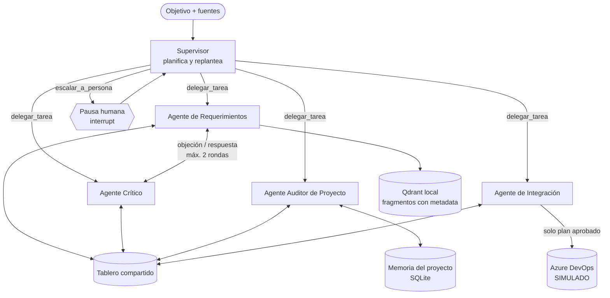

# BacklogGuard · Del Dicho al Backlog

Sistema multiagente que convierte reuniones, minutas y preventa en un backlog verificado, trazable y aprobado por personas antes de publicarse en Azure DevOps.

> Trabajo Final Integrador · Certificación Profesional en AI Agent Developer · ITBA Educación Ejecutiva
> Versión de entrega: `v1.0-tfi` · Entrega: domingo 6 de diciembre de 2026, 23:59 h

---

## 1. Nombre del proyecto
**BacklogGuard** (subtítulo: *Del Dicho al Backlog*).

## 2. Integrantes
⚠️ A COMPLETAR: nombre y apellido de todos los integrantes.

## 3. Problema
En una factory de desarrollo o en el proceso de toma de requerimientos, entre lo que se vende, lo que se conversa con el cliente y lo que termina en el backlog hay varias pérdidas:

- **Historias generadas con IA que nadie verifica.** Un error de transcripción, una frase mal interpretada o un requerimiento inventado llegan al backlog con la misma apariencia que uno válido. El problema aparece recién al validar la historia, con ciclos de corrección.
- **Desalineación entre preventa y ejecución.** Lo tratado pero no vendido se desarrolla sin facturarse. Lo vendido pero no tratado queda sin definir hasta que bloquea.
- **Contradicciones y decisiones perdidas entre reuniones.** Se pierde cuál es la versión vigente, y las preguntas técnicas abiertas reaparecen tarde como impedimentos.
- **Refinamiento manual y lento.** Revisar historia por historia, completar criterios, buscar duplicados y cargar todo a mano consume horas de perfiles caros.
- **Falta de trazabilidad.** Es difícil reconstruir de qué reunión salió cada requerimiento y quién lo validó.

## 4. Usuario / destinatario
| Rol | Qué hace en el sistema |
|---|---|
| Full Stack IA Engineer | Usuario principal. Revisa el plan de publicación y decide: aprobar, editar o rechazar. |
| Product Owner (PO) | Resuelve los desacuerdos sin consenso entre agentes y valida que las historias reflejen lo acordado con el cliente. |
| Service manager | Aprueba o rechaza los cambios de alcance detectados contra la preventa. |

⚠️ A COMPLETAR: confirmar los roles finales del equipo de delivery.

## 5. Descripción
BacklogGuard recibe un **objetivo** (por ejemplo, "preparar el backlog del sprint 1" o "auditar las minutas de octubre") junto con las fuentes del proyecto: transcripciones, minutas y preventa. Un equipo de agentes lo resuelve:

1. Se fragmentan las fuentes con metadata (reunión, fecha, orador).
2. Se redactan épica, historias con criterios Gherkin, tareas y casos de prueba, **citando** los fragmentos que las sustentan.
3. Un agente crítico intenta refutar cada historia; el productor corrige o defiende.
4. Un auditor compara lo conversado con lo vendido y detecta contradicciones.
5. Las personas deciden en los puntos de riesgo.
6. Se arma un plan en *dry-run*, se aprueba y se publica en Azure DevOps solo lo aprobado, con las citas en cada work item.

**Flujo principal de la demo:** objetivo y fuentes, plan del Supervisor, historias con citas, objeción del Crítico y corrección, hallazgo de cambio de alcance, pausa humana, plan en dry-run, aprobación y publicación.

## 6. Arquitectura
Sistema **multiagente con supervisor planificador** (enfoque B de la consigna), implementado como grafo de **LangGraph**.



> ⚠️ A COMPLETAR: reemplazar o validar este diagrama contra la implementación final (`docs/arquitectura/`).

### Qué es real y qué es simulado
Para la entrega, esto es lo que funciona de verdad y lo que está simulado:

| Componente | Estado | Detalle |
|---|---|---|
| Modelos de lenguaje (Anthropic) | **Real** con `LIVE_MODE=1` | Sonnet, Opus y Haiku según `config/models.yaml`. Con `LIVE_MODE=0` la demo reproduce una corrida grabada, sin red ni costo. |
| **Azure DevOps** | **Simulado por defecto; cliente MCP sobre adaptador REST disponible** | `SimulatedBacklog` ([integrations/simulated.py](src/backlogguard/integrations/simulated.py)) sigue siendo el modo de demo y tests. En modo real, la aplicación consume un servidor MCP con Tools, Resource y Prompt; el servidor encapsula `AzureDevOpsBacklog` ([integrations/azure_devops.py](src/backlogguard/integrations/azure_devops.py)), que usa Azure DevOps Work Item Tracking REST API 7.1, descubre tipos/campos, mapea Scrum `User Story` a `Product Backlog Item` y gestiona JSON Patch y relaciones padre-hijo. Por defecto, cliente y servidor MCP corren en proceso; se puede ejecutar un endpoint Streamable HTTP de solo lectura. El PAT permanece en backend y las pruebas no escriben en Azure. |
| Publicación segura | **Real** | Plan en *dry-run*, aprobación humana por rol, hash del plan, revalidación contra el backlog e idempotencia por requisito y versión: todo corre igual contra el simulado. |
| Fuentes del proyecto | **Real** | Preventa en PDF y minutas o transcripciones (`.txt`, `.md`, `.vtt` y Word `.docx`) cargadas por la persona. |
| Verificación de citas | **Real**, determinística | Cada cita se compara literalmente contra el fragmento de la fuente; las que no coinciden se descartan o se objetan. |
| Recuperación de fragmentos | **Léxica, en memoria** | Búsqueda determinística (BM25). Los embeddings reales y Qdrant están disponibles como extra (`rag`), pero la demo y los tests no los usan. |
| Demo sin costo | **Grabada** | `evals/recordings/demo_acme.json`; reproduce una corrida real, no genera respuestas nuevas. |

### Agentes, tools y skills
| Agente | Tools | Skill |
|---|---|---|
| Supervisor | `delegar_tarea`, `escalar_a_persona` | `politica-de-ruteo-y-escalamiento` |
| Requerimientos | `ingestar_y_fragmentar`, `buscar_en_fuentes`, `redactar_historia` | `refinamiento-backlog` |
| Crítico | `verificar_cita`, `buscar_contraevidencia`, `evaluar_dor_invest` | `revision-adversarial` |
| Auditor de Proyecto | `comparar_con_preventa`, `detectar_contradicciones`, `consultar_decisiones_vigentes`, `registrar_decision_aprobada` | `auditoria-de-alcance` |
| Integración | `buscar_en_backlog`, `armar_plan_dry_run`, `revalidar_plan`, `ejecutar_plan_aprobado`, `ejecutar_retiros_aprobados` | `publicacion-segura` |

### Estado y memoria
- **Estado de la corrida:** checkpoints del grafo en SQLite (`SqliteSaver` de LangGraph), con un `thread_id` por corrida, y snapshots versionados del tablero en JSON (patrón `JsonCheckpointStore` de la clase 11). Permite pausar, cerrar el proceso y reanudar.
- **Memoria del proyecto:** `MemoryStore` en SQLite (clase 10) con scope por proyecto, Write Gate, TTL y `supersede`. Guarda decisiones vigentes y preguntas pendientes; una decisión que evolucionó deja la anterior como histórica. Solo se escribe tras la aprobación humana.
- **Tablero compartido:** estado de cada ítem (borrador, objetado, sustentado, aprobado, excluido), objeciones, hallazgos y registro de mensajes entre agentes.

### Human-in-the-Loop
Las pausas se disparan por condición de riesgo (`interrupt` de LangGraph), no son pasos fijos:
- **Cambio de alcance detectado:** decide el service manager.
- **Desacuerdo sin consenso:** decide el PO.
- **Plan de publicación:** siempre requiere aprobación (aprobar, editar o rechazar) antes de escribir.

### Reglas fuera del modelo
Policy gate por rol (cada agente ve solo sus tools), imposibilidad de escribir sin plan aprobado, claves de idempotencia, revalidación del plan contra el backlog actual, topes de rondas y de pasos, y tratamiento del texto de las reuniones como entrada no confiable.

## 7. Decisiones técnicas
⚠️ A COMPLETAR con los resultados reales. Borrador de las decisiones y su justificación:

| Decisión | Justificación |
|---|---|
| Multiagente en vez de agente único | Quien genera no debe ser quien verifica, y solo un agente debe poder escribir en el sistema externo. Se contrasta con una línea base de agente único (sección 12). |
| Crítico con modelo y prompt independientes | Reduce los sesgos correlacionados con el productor. |
| LangGraph | Grafo con estado, checkpoints e `interrupt` para el Human-in-the-Loop. |
| RAG con Qdrant local | Las citas dependen de recuperar fragmentos con reunión, fecha y orador. |
| SQLite y JSON | SQLite para la memoria del proyecto y los checkpoints del grafo; JSON versionado para los snapshots del tablero. Es el enfoque del curso (clases 10 y 11): simple y reproducible. |
| Gateway de Azure DevOps con implementación simulada y servidor MCP sobre REST | Tests y demo estables aunque el servicio externo no responda; el servidor MCP encapsula REST y el cliente conserva el contrato `BacklogGateway`. |
| Skills en formato Agent Skills | Criterio de cada rol versionado y reutilizable fuera de los prompts. |
| Validación con Pydantic y policy gate | Salidas estructuradas y autorización fuera del modelo. |

**Modelos por agente** (`config/models.yaml`, punto de partida que la evaluación contrasta en A/B):

| Agente | Modelo | Por qué |
|---|---|---|
| Requerimientos (productor) | `claude-sonnet-5-5` (esfuerzo medio) | Es quien convierte la reunión en historias: si cubre poco, el resto del sistema no lo puede compensar. En la prueba con documentos reales `claude-haiku-5-5` cubrió la mitad de los requisitos, así que se pasó a Sonnet; `gemini-3.8-flash` (modelo del curso) se descartó por la cuota gratuita. ⚠️ A COMPLETAR: resultado del A/B de modelos. |
| Crítico | `claude-opus-5-5` | Es la compuerta de calidad; pensado para ser de otro proveedor que el productor (hoy, con Haiku temporal, solo difiere el modelo). El código impide configurar el mismo proveedor y modelo. |
| Auditor de Proyecto | `claude-opus-5-5` | Pocas llamadas de juicio delicado (evolución contra contradicción). |
| Supervisor | `claude-sonnet-5-5` (esfuerzo bajo) | Salidas cortas y buen criterio de ruteo. |
| Integración | `claude-haiku-5-5` (esfuerzo bajo) | Casi todo es código determinístico (hash, idempotencia). |

⚠️ A COMPLETAR: resultados del A/B de modelos.

## 8. Instalación
⚠️ Provisional: verificar los comandos contra el repositorio final.

Requisitos: Git, Docker y Docker Compose; para ejecución local, Python 3.12. ⚠️ A COMPLETAR: versiones exactas.

```bash
git clone <URL-DEL-REPOSITORIO>
cd backlogguard
git checkout v1.0-tfi
cp .env.example .env   # y completar las variables (sección 9)
python -m venv .venv && source .venv/bin/activate   # Windows: .venv\Scripts\activate
pip install -e ".[dev,llm,rag,graph,ui]"
pytest -q   # no requiere claves ni red
```

## 9. Configuración
Copiá `.env.example` a `.env`. **No se versionan claves, tokens ni credenciales.**

| Variable | Descripción |
|---|---|
| `LIVE_MODE` | `0` (por defecto): sin red ni costo; la pantalla reproduce la corrida grabada. `1`: usa los modelos reales. |
| `ANTHROPIC_API_KEY`, `GEMINI_API_KEY` | Claves de los proveedores (solo con `LIVE_MODE=1`). |
| `AZDO_MODE` | `simulated` (por defecto y recomendado para tests/demo); `real` habilita el cliente MCP y su servidor REST interno solo con `APP_ENV=development`. |
| `AZDO_ORG_URL`, `AZDO_PROJECT` | Organización y proyecto de Azure DevOps. En `.env.example` se configura `https://tp-itba.visualstudio.com/` y `TP-ITBA`. |
| `AZDO_MCP_ENDPOINT` | Opcional; endpoint MCP remoto Streamable HTTP. Vacío conecta al servidor MCP en proceso. El servidor HTTP suministrado es de solo lectura. |
| `AZDO_TOKEN` | PAT de desarrollo, únicamente en `.env` local ignorado por Git o un secret store del backend. Nunca usarlo en frontend, logs, prompts ni producción. No compartirlo por chat. |
| `AZDO_EPIC_TYPE`, `AZDO_STORY_TYPE`, `AZDO_TASK_TYPE` | Opcionales para sobreescribir el descubrimiento; en Scrum la historia se mapea a `Product Backlog Item` si no existe `User Story`. |
| `BACKLOGGUARD_DB_PATH`, `BACKLOGGUARD_CHECKPOINT_PATH` | Rutas de persistencia (ver `.env.example`). |
Otros archivos de configuración: `config/models.yaml` (modelo por agente), `config/policy.yaml` (tools por rol y condiciones de pausa), `config/people.yaml` (personas y roles que pueden decidir), `config/budgets.yaml` (presupuesto de una corrida) y ⚠️ `config/context_budget.yaml` (presupuesto de contexto, pendiente).

La autenticación PAT es solo una opción de desarrollo controlado y el adaptador la rechaza fuera de `APP_ENV=development`. Mantener `AZDO_MODE=simulated` para tests/demo; configurar `AZDO_MODE=real` no se debe hacer hasta validar permisos y proceso en el proyecto. El token nunca se serializa con la configuración segura (`Settings.safe_dict`).
Las publicaciones simuladas y las reales usan registros de idempotencia separados (`publicaciones.sqlite` y `publicaciones_azure.sqlite`) para que una publicación local previa no se considere aplicada en Azure.

Para levantar el servidor MCP HTTP de diagnóstico (solo lectura), configurar `AZDO_MODE=real` y las credenciales del backend en `.env`, y ejecutar:

```bash
python -m backlogguard.integrations.mcp_server
```

El servidor se liga únicamente a `127.0.0.1:8000`; un cliente puede usar `AZDO_MCP_ENDPOINT=http://127.0.0.1:8000/mcp`. El flujo de publicación de la aplicación usa el servidor en proceso y sigue exigiendo aprobación humana. No se realizan escrituras Azure por HTTP.

## 10. Ejecución
**Local, sin Docker** (Windows: `.venv\Scripts\...`; Linux/Mac: `.venv/bin/...`):

```bash
# Pantalla (Streamlit). Con LIVE_MODE=0 reproduce la corrida grabada en evals/recordings/demo_acme.json.
streamlit run src/backlogguard/ui/app.py --server.address localhost

# Corrida por terminal: muestra a los agentes en vivo y se pausa cuando necesita una persona.
python scripts/run_pipeline.py --reset --seed        # --auto aprueba todo con la persona que corresponde
python scripts/decidir.py <corrida>                  # ver el pedido pendiente; --accion approve|edit|reject para decidir

# Usar tus propios documentos (preventa en PDF; reunión o minuta en texto, VTT o Word); requiere LIVE_MODE=1 para correr.
python scripts/importar_fuentes.py --preventa preventa.pdf --preventa-nombre "Propuesta" --preventa-fecha 2025-10-01 \
    --reunion minuta.txt --reunion-nombre "Inception" --reunion-fecha 2026-01-25
python scripts/importar_fuentes.py --listar           # --limpiar vuelve a las fuentes de ejemplo

# Grabar una corrida real (gasta tokens) para reproducirla después sin costo.
LIVE_MODE=1 python scripts/grabar_demo.py
```

⚠️ Provisional (Docker, todavía sin construir):
```bash
docker compose up --build
```
- Interfaz (Streamlit): ⚠️ `http://localhost:<puerto>`.

## 11. Uso
Recorrido principal (⚠️ ajustar a la interfaz final):

1. Abrir la interfaz y crear un objetivo: *"Preparar el backlog del sprint 1"*.
2. Cargar la preventa y las minutas de `evals/dataset/`.
3. Ver en el tablero cómo se generan las historias con sus citas.
4. Observar la objeción del Crítico y la corrección del productor.
5. Resolver la pausa por cambio de alcance (service manager).
6. Revisar el plan en dry-run. Si un work item existe y difiere del resultado revisado, comparar en la pantalla los campos actuales con los propuestos; aprobar su actualización conserva el mismo ID en Azure.
7. En **Sincronizar con Azure**, si no hay una aprobación pendiente porque la aplicación se reinició o la corrida terminó, seleccionar una corrida guardada y usar **Comparar historias con Azure**. El plan vuelve a comparar las historias aprobadas con el destino actual; elegir las operaciones y aprobarlas explícitamente para escribir.
8. Ver los work items en el backlog (Avanzado → Backlog simulado conserva el nombre de la pantalla): en modo simulado son locales; en modo real se consulta el proyecto Azure configurado.
9. Para retirar un requisito publicado, marcarlo explícitamente desde **Avanzado → Catálogo**, indicar el motivo y confirmar. Esto lo excluye de futuras corridas, pero todavía no escribe en Azure.
10. En **Sincronizar con Azure**, analizar los cambios retirables, revisar el dry-run y aprobar aparte el retiro reversible: el work item y sus vínculos se conservan; su estado cambia a la categoría Azure `Removed`. Los ítems manuales, procesos sin ese estado y padres con hijos activos quedan bloqueados. La ausencia de un requisito en una nueva versión de un PDF no implica borrarlo. En modo simulado no se escribe en Azure.

**Demo y video:** ⚠️ URL de la demo (si existe) y del video de respaldo de 3 a 5 minutos.

## 12. Evaluación
⚠️ A COMPLETAR con resultados reales.

- **Dataset:** proyecto ficticio con una preventa, cuatro minutas y errores sembrados de seis tipos: requerimiento inventado, error de transcripción, contradicción real, decisión que evolucionó, tratado pero no vendido y vendido pero no tratado (`evals/dataset/`).
- **Ejecución:** ⚠️ comando que corre la evaluación (por ejemplo, `python -m evals.run`).
- **Métricas:** detección por tipo de error, citas válidas, ruteo correcto, rondas por historia, Precision@k / Recall@k / MRR de la recuperación, costo y latencia.
- **Línea base:** el mismo dataset sobre un agente único, para justificar la arquitectura.

| Métrica | Multiagente | Agente único |
|---|---|---|
| Detección de cita falsa | ⚠️ | ⚠️ |
| Detección de requerimiento inventado | ⚠️ | ⚠️ |
| Detección de contradicción real | ⚠️ | ⚠️ |
| Decisión evolucionada marcada como contradicción (falso positivo) | ⚠️ | ⚠️ |
| Cambios de alcance detectados | ⚠️ | ⚠️ |
| Rondas promedio por historia | ⚠️ | n/a |
| Costo y latencia por corrida | ⚠️ | ⚠️ |

**Tests:** ⚠️ `pytest tests/` (cada tool y el recorrido principal). Resultados en `evals/resultados/`.

## 13. Limitaciones
⚠️ A COMPLETAR al cierre. Limitaciones previstas:
- Datos sintéticos; no se validó con material real de clientes.
- La evaluación usa un dataset pequeño con errores sembrados.
- Las pruebas y la demo usan `SimulatedBacklog`; la conexión real REST aún debe validarse en el proyecto Azure autorizado. PAT solo para desarrollo, no para producción.
- El Crítico y el productor usan modelos de lenguaje; la verificación textual de citas es determinística, pero el juicio de sustento no lo es.
- Quedan fuera del alcance: notificaciones reales, deduplicación semántica avanzada y varios proyectos en simultáneo.

---

## Estructura del repositorio
```text
backlogguard/
├── README.md · AGENTS.md · TAREAS.md · .env.example
├── config/            # models, policy y context_budget
├── src/backlogguard/
│   ├── agents/        # un agent.md por agente
│   ├── tools/         # tools + registry y policy gate
│   ├── skills/        # cinco skills (SKILL.md, references, scripts, assets)
│   ├── context/       # skill loader y context builder
│   ├── memory/        # memoria del proyecto y checkpoints
│   ├── board/         # modelos Pydantic y tablero
│   ├── graph/         # grafo de LangGraph
│   ├── integrations/  # Azure DevOps (simulado; el real queda como extensión)
│   └── ui/            # interfaz Streamlit
├── tests/
├── evals/             # dataset y resultados
└── docs/              # arquitectura y decisiones técnicas
```
