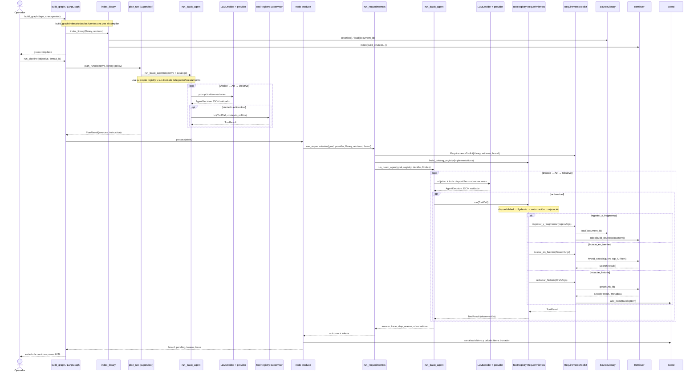
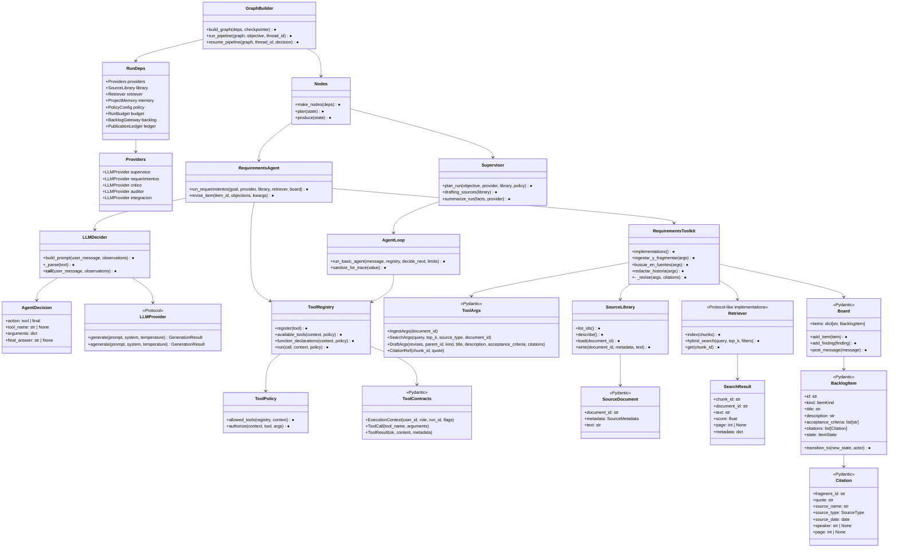

# Arquitectura implementada: flujo de Requerimientos

Estos diagramas describen el código que existe hoy, no una arquitectura objetivo.
El flujo integrado corresponde a `build_graph` → `plan` → `produce`; el script
`scripts/run_requerimientos.py` también permite ejecutar el productor directamente,
sin Supervisor ni grafo.

## 1. Secuencia de llamadas reales

La secuencia muestra el flujo de producción dentro del pipeline. Las llamadas al
LLM ocurren en `LLMDecider` mediante el proveedor configurado. El modelo devuelve
una decisión JSON validada; no se usa function calling nativo para este ciclo.



**Alcance del dibujo:** después de `produce`, el grafo pasa por revisión del
Crítico, auditoría y los nodos de decisión/integración configurados. No se
despliegan aquí porque el foco es la producción de requerimientos.

## 2. Clases, contratos y métodos existentes

`●` indica que el método tiene implementación funcional en este flujo; `◐`
indica que su resultado depende de otro componente o que el contrato permite
respuestas no implementadas. No hay una clase `AgentFactory`: la composición
se realiza con `build_graph`, `make_nodes`, `plan_run` y `run_requerimientos`.



### Implementado y marcadores

- Las tres tools del productor están conectadas a handlers reales por
  `RequirementsToolkit.implementations()`. Sus argumentos y resultados usan
  modelos Pydantic, y las llamadas pasan por `ToolRegistry`.
- El catálogo declara 16 tools en total. Las que no se inyectan para un agente
  usan un handler que devuelve `not_implemented`; esto es un marcador, no una
  implementación funcional de esas herramientas.
- El proveedor concreto depende de configuración: se inyecta por `LLMProvider`
  (por ejemplo, `FakeProvider` para pruebas o proveedores externos en modo live).
- `summarize_run` tiene un resumen determinístico alternativo si falla el LLM;
  no es un stub.

## 3. Flujo de datos y llamadas a herramientas

```mermaid
flowchart TD
    SourceFiles["Fuentes .md con front matter YAML<br/>source_name, source_type, source_date, layout"]
    Library["SourceLibrary<br/>SourceDocument + SourceMetadata (Pydantic)"]
    Chunks["build_chunks<br/>fragmentos con chunk_id y metadata"]
    Embed["EmbeddingProvider"]
    Retriever["InMemoryRetriever o QdrantRetriever<br/>índice denso + búsqueda léxica BM25/RRF"]

    Goal["objective + instrucción + fuentes seleccionadas<br/>(RunState / nodo produce)"]
    Prompt["LLMDecider.build_prompt<br/>objetivo, declaraciones visibles, observaciones"]
    Provider["LLMProvider.generate<br/>Fake / Gemini / Anthropic según config"]
    Decision["AgentDecision Pydantic<br/>JSON: tool o final"]

    IngestArgs["IngestArgs Pydantic<br/>document_id"]
    SearchArgs["SearchArgs Pydantic<br/>query, top_k, filtros opcionales"]
    DraftArgs["DraftArgs Pydantic<br/>kind, title, descripción, criterios, citations"]
    Registry["ToolRegistry.run<br/>disponibilidad → validación → policy/rol → handler"]

    SearchResult["SearchResult[] → ToolResult<br/>texto y metadata del fragmento"]
    ChunkRef["CitationRef Pydantic<br/>chunk_id + quote"]
    Citation["Citation Pydantic<br/>metadata tomada del fragmento"]
    Item["BacklogItem Pydantic<br/>estado inicial BORRADOR"]
    Board["Board compartido<br/>serializado de vuelta a RunState"]
    Trace["trace + observations + stop_reason + tokens"]

    SourceFiles --> Library
    Library --> Chunks
    Chunks --> Embed
    Embed --> Retriever

    Goal --> Prompt
    Prompt --> Provider
    Provider --> Decision
    Decision --> ToolCall["ToolCall Pydantic<br/>tool_name + arguments"]
    ToolCall --> Registry
    IngestArgs --> Registry
    SearchArgs --> Registry
    DraftArgs --> Registry

    Registry -->|ingestar_y_fragmentar| Library
    Library -->|documento fuente| Chunks
    Chunks -->|index(chunks)| Retriever
    Registry -->|buscar_en_fuentes| Retriever
    Retriever --> SearchResult
    SearchResult -->|observación al siguiente turno| Prompt
    DraftArgs -->|citations| ChunkRef
    ChunkRef -->|get(chunk_id)| Retriever
    Retriever --> Citation
    Registry -->|redactar_historia| Citation
    Citation --> Item
    Item --> Board
    Board --> Trace
    Registry -->|ToolResult| Trace
    Decision -->|action=final| Trace
```

### Contratos y límites observables

- `SourceLibrary` solo resuelve identificadores de fuente, valida su metadata y
  carga archivos de su carpeta controlada. `build_graph` indexa **todas** las
  fuentes existentes, incluida la preventa. `plan_run` selecciona como fuentes
  de redacción solo reuniones y minutas, y el prompt de producción prohíbe usar
  la preventa; el retriever del productor, sin embargo, también contiene los
  fragmentos de preventa y los filtros de búsqueda son opcionales. La exclusión
  está guiada por plan/prompt, no impuesta como filtro obligatorio por el
  `RequirementsToolkit`.
- `redactar_historia` exige que cada `chunk_id` exista y construye la cita con
  metadata del fragmento, pero no comprueba que `quote` aparezca literalmente
  en su texto. La validación textual de la cita no forma parte de esta tool.
- `acceptance_criteria` se valida como Gherkin en `DraftArgs`; el ítem se agrega
  al tablero en estado `BORRADOR`. El paso de producción no lo aprueba.
- La búsqueda híbrida combina embeddings y BM25 mediante RRF; los embeddings
  dependen del `EmbeddingProvider` elegido en la configuración de runtime.
- `scripts/run_requerimientos.py` configura fuente, retriever y tablero e invoca
  directamente `run_requerimientos`; esa ruta de prueba no llama al Supervisor.

## Referencias de implementación

- Orquestación: [`graph/builder.py`](../../src/backlogguard/graph/builder.py),
  [`graph/nodes.py`](../../src/backlogguard/graph/nodes.py) y
  [`graph/deps.py`](../../src/backlogguard/graph/deps.py).
- Supervisor: [`agents/supervisor/__init__.py`](../../src/backlogguard/agents/supervisor/__init__.py).
- Productor: [`agents/requerimientos/__init__.py`](../../src/backlogguard/agents/requerimientos/__init__.py)
  y [`tools/requerimientos.py`](../../src/backlogguard/tools/requerimientos.py).
- Ciclo y tool runtime: [`agents/loop.py`](../../src/backlogguard/agents/loop.py),
  [`agents/decider.py`](../../src/backlogguard/agents/decider.py),
  [`tools/registry.py`](../../src/backlogguard/tools/registry.py) y
  [`tools/policy.py`](../../src/backlogguard/tools/policy.py).
- Fuentes, recuperación y tablero: [`rag/sources.py`](../../src/backlogguard/rag/sources.py),
  [`rag/retrieval.py`](../../src/backlogguard/rag/retrieval.py) y
  [`board/models.py`](../../src/backlogguard/board/models.py).
